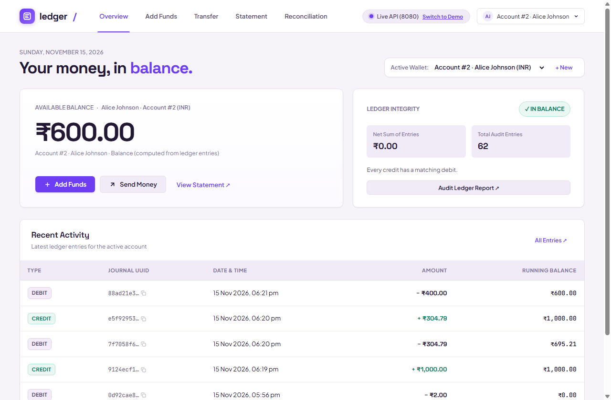
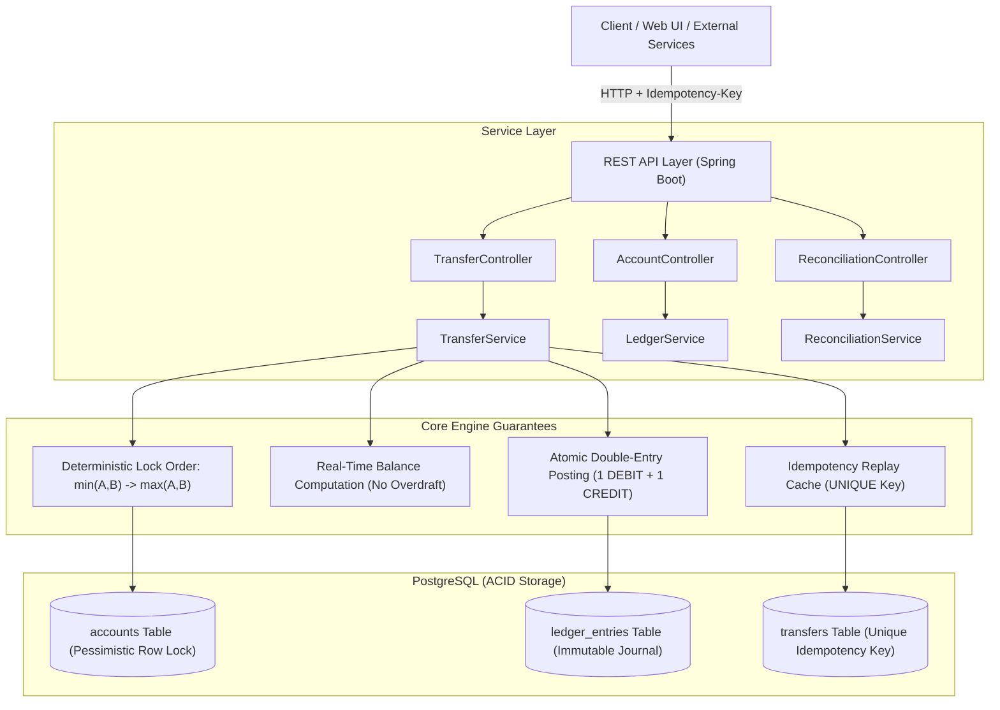
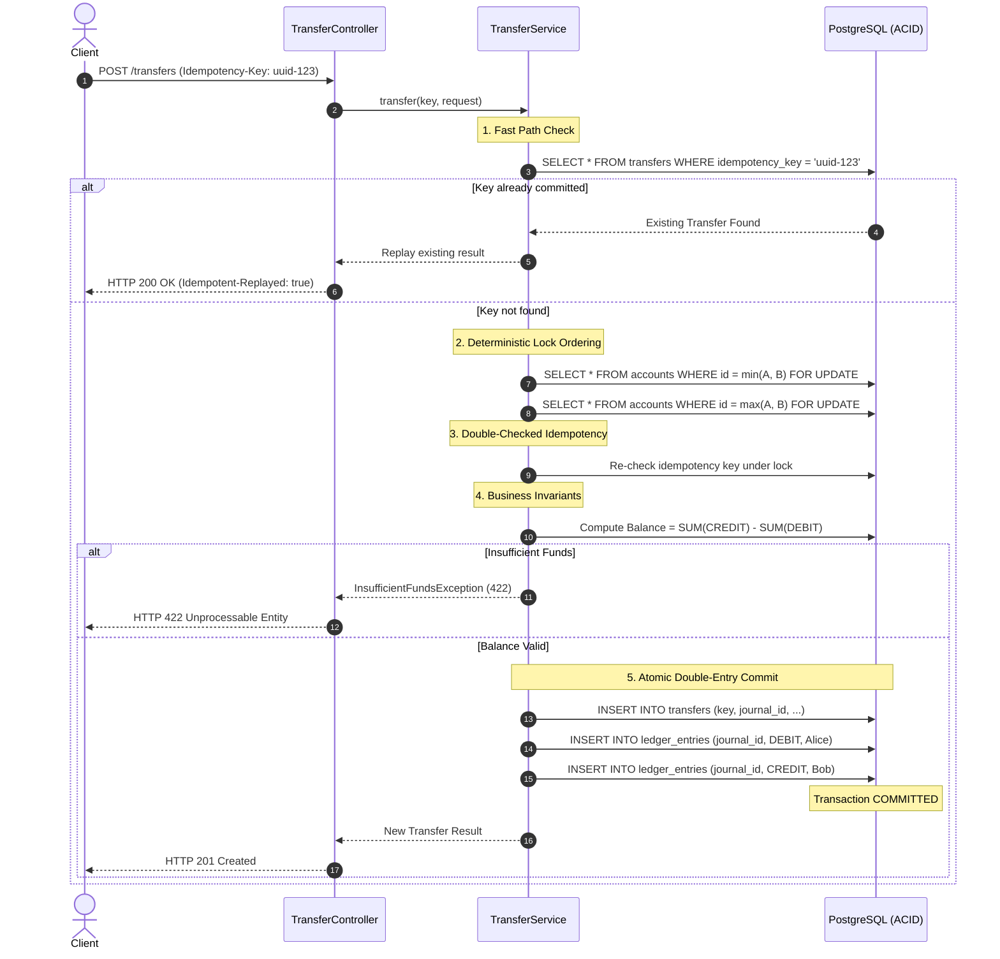
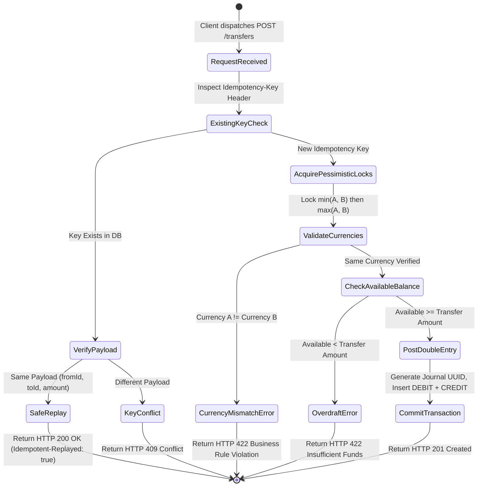
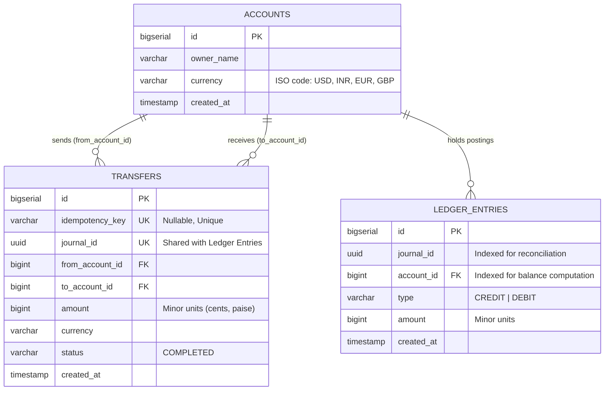
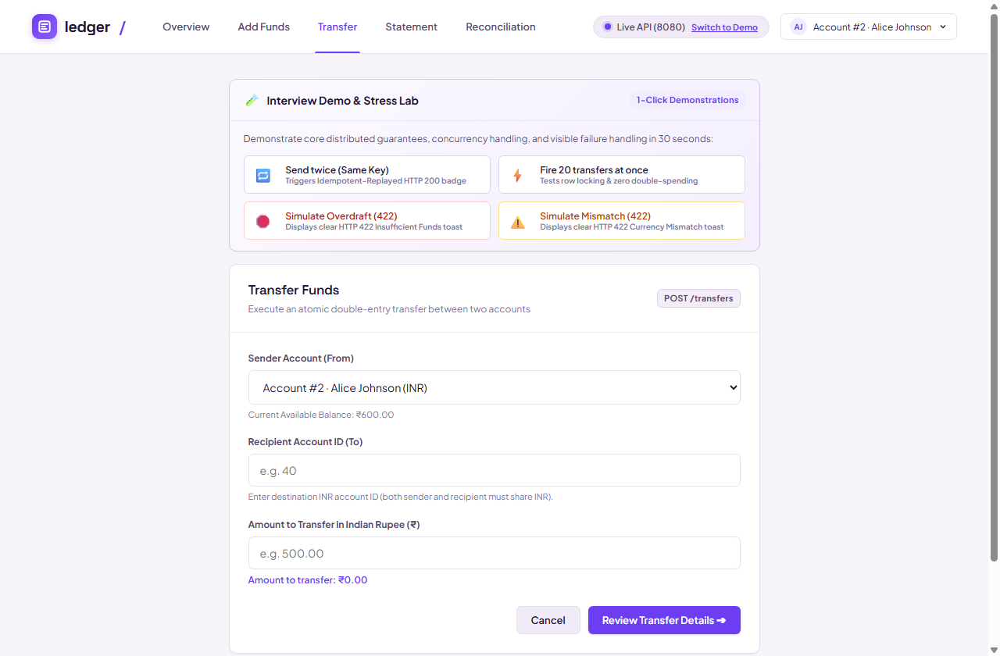
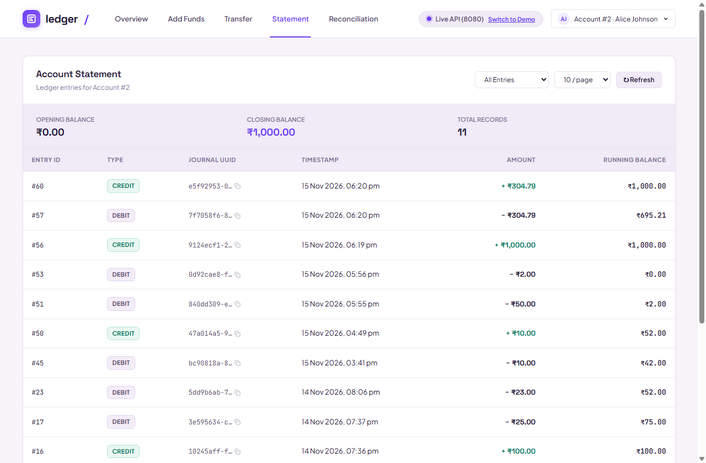
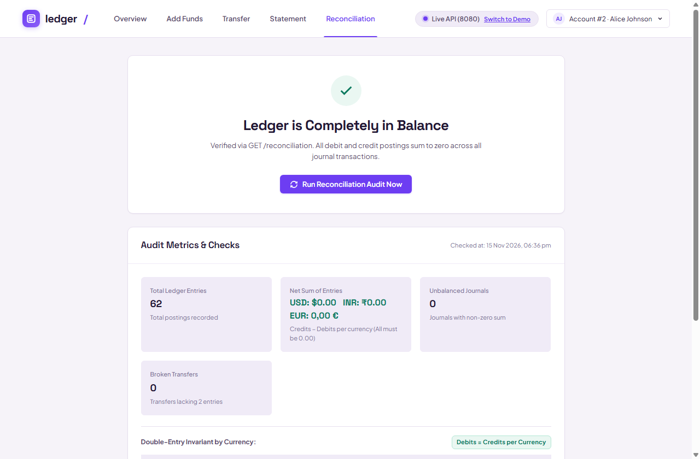

# 🏦 Wallet Ledger Service

[](https://openjdk.org/)
[](https://spring.io/projects/spring-boot)
[](https://www.postgresql.org/)
[](https://en.wikipedia.org/wiki/Double-entry_bookkeeping)
[](https://stripe.com/docs/api/idempotent_requests)
[](LICENSE)

A high-integrity, multi-currency financial wallet and ledger system engineered with strict **Double-Entry Bookkeeping**, **Pessimistic Concurrency Controls**, **Deterministic Deadlock Avoidance**, and **Distributed Idempotency Guarantees**.

Includes a built-in single-page web dashboard, live OpenAPI/Swagger documentation, and automated continuous reconciliation audit verification.

<p align="center">
  
</p>

---

## 📑 Table of Contents
- [Architecture & Design Principles](#-architecture--design-principles)
- [System Architecture Diagram](#-system-architecture-diagram)
- [Transaction Execution & Locking Sequence](#-transaction-execution--locking-sequence)
- [Transfer Lifecycle & Idempotency State Machine](#-transfer-lifecycle--idempotency-state-machine)
- [Entity-Relationship Diagram (ERD)](#-entity-relationship-diagram-erd)
- [Core Engineering Highlights](#-core-engineering-highlights)
  - [1. Double-Entry Accounting Invariant](#1-double-entry-accounting-invariant)
  - [2. Deadlock Prevention via Deterministic Lock Ordering](#2-deadlock-prevention-via-deterministic-lock-ordering)
  - [3. Distributed Idempotency Engine](#3-distributed-idempotency-engine)
  - [4. Multi-Currency Partitioning & Global Auditing](#4-multi-currency-partitioning--global-auditing)
- [REST API Specification](#-rest-api-specification)
- [Interactive Web Dashboard](#-interactive-web-dashboard)
- [Getting Started & Local Setup](#-getting-started--local-setup)
- [Running Concurrency Verification Tests](#-running-concurrency-verification-tests)

---

## 🏛 Architecture & Design Principles



---

## 🔄 Transaction Execution & Locking Sequence

When Alice transfers money to Bob, circular-wait deadlocks are eliminated by enforcing a strict global lock acquisition order: $\min(\text{fromId}, \text{toId})$ followed by $\max(\text{fromId}, \text{toId})$.



---

## 🔀 Transfer Lifecycle & Idempotency State Machine



---

## 🗄 Entity-Relationship Diagram (ERD)



---

## ⚡ Core Engineering Highlights

### 1. Double-Entry Accounting Invariant
Account balances are **never** stored as mutable columns (which are prone to race conditions, lost updates, and ledger drift). Instead, account balances are computed as the net sum of immutable historical ledger entries:

$$\text{Balance} = \sum \text{CREDITS} - \sum \text{DEBITS}$$

Every transfer or deposit operation writes two equal and opposite entries bound by a single immutable `journal_id`:
1. `DEBIT` on the source account
2. `CREDIT` on the destination account

The universal ledger invariant holds at all times across all currencies:

$$\sum_{\text{all postings}} \text{CREDITS} - \sum_{\text{all postings}} \text{DEBITS} \equiv 0$$

### 2. Deadlock Prevention via Deterministic Lock Ordering
When two users concurrently initiate bilateral transfers (Alice transfers \$50 to Bob while Bob simultaneously transfers \$30 to Alice), standard locking can cause a circular-wait deadlock:
- **Thread 1:** Locks Account 1 (Alice), waits for Account 2 (Bob).
- **Thread 2:** Locks Account 2 (Bob), waits for Account 1 (Alice).

**Resolution:**
The system sorts account identifiers before acquiring database row locks:
```java
Long firstId = fromId < toId ? fromId : toId;
Long secondId = fromId < toId ? toId : fromId;

Account first = accountRepository.findByIdForUpdate(firstId);
Account second = accountRepository.findByIdForUpdate(secondId);
```
Both threads request locks in identical ascending numerical order (`#1` then `#2`), completely eliminating circular wait conditions at the database level.

### 3. Distributed Idempotency Engine
Network timeouts and client retries commonly cause duplicate financial transactions. This service implements the Stripe-standard `Idempotency-Key` protocol:
- **First Request:** Generates and executes the transfer, committing the key and journal within a single transaction. Returns `HTTP 201 Created`.
- **Replay with Same Key & Payload:** Identifies the existing completed key and returns the identical response with `HTTP 200 OK` and header `Idempotent-Replayed: true`. No duplicate debit occurs.
- **Replay with Conflicting Payload:** If a previously committed key is reused with different accounts or amounts, the request is rejected immediately with `HTTP 409 Conflict`.
- **Concurrent Race Resolution:** If two identical requests race simultaneously, PostgreSQL's `UNIQUE` constraint triggers a `DataIntegrityViolationException` on the losing transaction, which recovers safely in a clean transaction and returns the recorded replay.

### 4. Multi-Currency Partitioning & Global Auditing
- **Strict Currency Boundaries:** Accounts support `USD`, `INR`, `EUR`, and `GBP`. Transfers between mismatched currencies are blocked upfront with clear error responses.
- **Isolated Continuous Reconciliation (`GET /reconciliation`):**
  Auditing groups ledger entries per currency under `REPEATABLE_READ` snapshot isolation. It confirms:
  1. Every currency's net sum independently equals zero ($\Delta_{\text{USD}} = 0, \Delta_{\text{INR}} = 0$).
  2. Every journal transaction contains perfectly balanced debit and credit entries.
  3. Every transfer corresponds to exactly two balanced ledger postings.

---

## 📡 REST API Specification

### 1. Accounts
| Method | Endpoint | Description |
|---|---|---|
| `POST` | `/accounts` | Create an account with an owner and ISO currency (`USD`, `INR`, `EUR`, `GBP`) |
| `GET` | `/accounts` | List all active accounts (excluding system funding accounts) |
| `GET` | `/accounts/{id}` | Fetch account metadata |
| `GET` | `/accounts/{id}/balance` | Compute and return the real-time balance from ledger entries |
| `POST` | `/accounts/{id}/deposit` | Deposit funds credited against the system funding pool (`SYSTEM_FUNDING`) |
| `GET` | `/accounts/{id}/statement` | Fetch paginated statement with running balance computed point-in-time |

#### Example: Create an Account
```bash
curl -X POST http://localhost:8080/accounts \
  -H "Content-Type: application/json" \
  -d '{
    "ownerName": "Alice Johnson",
    "currency": "USD"
  }'
```
**Response (`201 Created`):**
```json
{
  "id": 1,
  "ownerName": "Alice Johnson",
  "currency": "USD",
  "createdAt": "2026-11-15T09:30:00Z"
}
```

---

### 2. Transfers
| Method | Endpoint | Header Required | Description |
|---|---|---|---|
| `POST` | `/transfers` | `Idempotency-Key: <UUID>` | Execute an atomic double-entry transfer between accounts |
| `POST` | `/transfers/{id}/reverse` | None | Post a compensating double-entry journal reversal (fails with 422 if funds spent or already reversed) |
| `GET` | `/transfers` | None | List recent transfers (optional query parameter `?accountId=<ID>`) |
| `GET` | `/transfers/{id}` | None | Fetch specific transfer record and current status (`COMPLETED` or `REVERSED`) |

#### Example: Execute a Transfer
```bash
curl -i -X POST http://localhost:8080/transfers \
  -H "Content-Type: application/json" \
  -H "Idempotency-Key: 8a4b3c2d-1e0f-4a5b-9c8d-7e6f5a4b3c2d" \
  -d '{
    "fromAccountId": 1,
    "toAccountId": 46,
    "amount": 2500
  }'
```
**First Dispatch (`201 Created`):**
```json
{
  "transferId": 102,
  "journalId": "b1a2c3d4-e5f6-7a8b-9c0d-1e2f3a4b5c6d",
  "fromAccountId": 1,
  "toAccountId": 46,
  "amount": 2500,
  "currency": "USD",
  "status": "COMPLETED",
  "createdAt": "2026-11-15T09:35:10Z"
}
```
**Second Dispatch with Same Key (`200 OK` with Replay Header):**
```http
HTTP/1.1 200 OK
Idempotent-Replayed: true
Content-Type: application/json
```

#### Example: Reverse a Transfer via Compensating Journal
```bash
curl -i -X POST http://localhost:8080/transfers/102/reverse
```
**Response (`200 OK`):**
```json
{
  "transferId": 103,
  "journalId": "9c8b7a6d-5e4f-3a2b-1c0d-e2f3a4b5c6d7",
  "fromAccountId": 46,
  "toAccountId": 1,
  "amount": 2500,
  "currency": "USD",
  "status": "COMPLETED",
  "createdAt": "2026-11-15T09:36:00Z"
}
```
*Note: In double-entry accounting, reversals **never mutate or delete** past entries. The reversal issues a new compensating journal transaction (DEBIT recipient, CREDIT original sender). If the recipient has already spent the funds, the endpoint rejects with `422 Unprocessable Entity`.*

---

### 3. Reconciliation & Audit
| Method | Endpoint | Description |
|---|---|---|
| `GET` | `/reconciliation` | Full audit report across all entries and currencies |

#### Example: Audit Ledger Health
```bash
curl -X GET http://localhost:8080/reconciliation
```
**Response (`200 OK`):**
```json
{
  "healthy": true,
  "totalEntries": 48,
  "netSumOfAllEntries": 0,
  "netSumByCurrency": {
    "USD": 0,
    "INR": 0,
    "EUR": 0,
    "GBP": 0
  },
  "unbalancedJournals": [],
  "transfersWithoutExactlyTwoEntries": 0,
  "checkedAt": "2026-11-15T09:40:00Z"
}
```

---

## 💻 Interactive Web Dashboard

The service bundles a modern, responsive single-page web dashboard natively served by Spring Boot at `http://localhost:8080/index.html`:

### Dashboard Previews & Core Views

#### 1. Overview & Real-Time Balance
Real-time computed wallet balance derived dynamically from immutable ledger debit and credit entries, quick action modals (Add Funds, Send Money), and real-time transaction history sorted newest-first.

<p align="center">
  
</p>

#### 2. Transfer Interface & 1-Click Interview Stress Lab
Enables instant demonstration of core distributed financial system guarantees in 30 seconds:
* **Send twice (Same Key) 🔁:** Dispatches identical requests with the same idempotency key, immediately rendering the `🔁 Idempotent-Replayed: true (HTTP 200)` badge without double-charging.
* **Fire 20 transfers at once ⚡:** Concurrently fires 20 transfer threads via `Promise.allSettled` to stress-test pessimistic row-locking (`PESSIMISTIC_WRITE`) and prove zero race conditions or double-spending.
* **Simulate Overdraft (422) 🛑 & Currency Mismatch (422) ⚠️:** Surfaces clear, actionable error toasts and validation banners directly from backend RFC 7807 problem details.

<p align="center">
  
</p>

#### 3. Account Statement & Running Balance Audit Trail
An immutable audit journal displaying every posting with unique cryptographic journal UUIDs, precise timestamps, transaction types (`DEBIT` / `CREDIT`), and calculated per-line running balances.

<p align="center">
  
</p>

#### 4. Global Double-Entry Reconciliation & Health Audit
Automated continuous verification checking that $\sum \text{Credits} - \sum \text{Debits} = 0$ partitioned across every active currency (`USD: $0.00`, `INR: ₹0.00`, `EUR: 0,00 €`), alongside zero unbalanced journals and zero broken transfer legs.

<p align="center">
  
</p>

### Frontend Engineering Highlights
- **Complete End-to-End REST Integration:**
  - **Live Auto-Handshake:** Automatically probes the backend upon page load (`/reconciliation`), locking the interface into **Live API (8080)** mode with zero manual configuration.
  - **Authoritative Account Synchronization:** Every dropdown (Active Wallet picker, Sender Account select, Deposit target) directly queries the PostgreSQL `/accounts` REST endpoint as the single source of truth, eliminating client-side drift or stale cached personas.
  - **Dynamic Currency Adaptation:** The UI reactively formats labels, inputs, and presets to match the active account's currency (`USD: $`, `EUR: €`, `INR: ₹`, `GBP: £`).
  - **Exposed Diagnostic Error Feedback:** Surfaces explicit backend error details (`err.detail`) directly in real-time toasts and inline alert cards instead of generic failure notices.
- **Transfer History & Compensating Reversals:** Dedicated transfer history table with one-click `Reverse ↩` action invoking `POST /transfers/{id}/reverse`, writing compensating journals without mutating ledger history.
- **Audit Center:** Real-time multi-currency double-entry audit cards confirming ledger integrity ($\sum \text{Debits} = \sum \text{Credits} = 0$) across all currencies.
- **Offline Simulator Toggle:** Optional in-memory simulation mode allowing UI exploration even when the backend is disconnected.

---

## 🚀 Getting Started & Local Setup

### Option A: 1-Command Full Stack (Docker Compose) 🐳
The fastest way to run the entire system (PostgreSQL 16 + Spring Boot App + Flyway Migrations + Dashboard) with zero local installations:

```bash
# Clone the repository
git clone https://github.com/yashjangrra/wallet-ledger-service.git
cd wallet-ledger-service

# Build and start both PostgreSQL and Spring Boot containers
docker compose up --build
```
> **Container Highlights:**
> - Multi-stage build using `eclipse-temurin:17-jre-alpine` (ultra-compact ~179MB image).
> - Runs under an unprivileged user (`ledgeruser`) with container JVM memory constraints (`MaxRAMPercentage=75.0`).
> - PostgreSQL healthcheck (`pg_isready`) prevents the application from starting until database connections are ready.

---

### Option B: Local IntelliJ IDEA Development

#### 1. Start PostgreSQL Only
```bash
docker compose up -d postgres
```

#### 2. Configure Database & Flyway Migrations
Verify `src/main/resources/application.yml`:
```yaml
spring:
  datasource:
    url: jdbc:postgresql://localhost:5432/ledger
    username: ledger
    password: ledger
  flyway:
    enabled: true
    baseline-on-migrate: true
    baseline-version: 0
    locations: classpath:db/migration
  jpa:
    hibernate:
      ddl-auto: validate
server:
  port: 8080
```
> **Fintech Standard:** Database schema is strictly governed by versioned Flyway migrations (`V1__init_schema.sql`, `V2__allow_reversed_transfer_status.sql`). Hibernate runs with `ddl-auto: validate` so that application startup never modifies the production schema without a reviewed migration.

#### 3. Run Application
Run `LedgerServiceApplication.java` in IntelliJ IDEA, or execute with the Maven Wrapper:
```bash
./mvnw spring-boot:run
```

---

### 🌐 Access Interfaces
- **Web Dashboard:** [http://localhost:8080/index.html](http://localhost:8080/index.html)
- **OpenAPI / Swagger UI:** [http://localhost:8080/swagger-ui.html](http://localhost:8080/swagger-ui.html)
- **Actuator Health Check:** [http://localhost:8080/actuator/health](http://localhost:8080/actuator/health)
- **Reconciliation Audit:** [http://localhost:8080/reconciliation](http://localhost:8080/reconciliation)

---

## 🧪 Comprehensive Verification & Test Suite

The project includes both multi-threaded concurrent race condition testing and full error-path integration testing:

### 1. Run Error-Path Integration Tests (`HTTP 400, 404, 409, 422`)
```bash
./mvnw test -Dtest=ErrorPathIntegrationTest
```
**14 Automated Error-Path Scenarios Verified:**
- `400 Bad Request`: Missing `Idempotency-Key` header, zero transfer amount, negative amount, blank owner name, negative deposit.
- `404 Not Found`: Non-existent account balance lookup, deposit into missing account, missing source/destination account on transfer, non-existent transfer reversal.
- `409 Conflict`: Idempotency key reused with a conflicting payload (mismatched accounts or amount).
- `422 Unprocessable Entity`: Same-account transfer attempt, currency mismatch (`USD vs INR`), insufficient funds / overdraft attempt, reversing an already-reversed transfer, reversal when recipient has already spent funds.

### 2. Run Concurrency & Stress Tests
```bash
./mvnw test -Dtest=ConcurrentTransferTest
```
- **Parallel Transfer Stress Test:** 20 concurrent threads attempting cross-transfers between accounts. Asserts zero deadlocks occur under high contention.
- **Overdraft Protection Test:** Simultaneous withdrawal attempts that exceed account balance. Asserts that only valid transfers commit and final computed balance never drops below zero.
- **Idempotency Key Race Test:** Concurrent requests firing the exact same idempotency key at the same millisecond. Asserts exactly one transaction commits and the other receives the safe replay.

### 3. Run Entire Test Suite
```bash
./mvnw test
```

## 📄 License
This project is open-source and available under the [MIT License](LICENSE).
